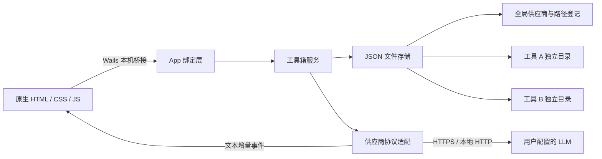

# 架构与数据格式

## 1. 分层



应用不部署认证服务器，也不需要本地常驻服务。Wails 在进程内连接 WebView 与 Go；前端不持有保存过的 API Key，不直接访问模型供应商。后端为一次请求创建 HTTP 客户端并在结束后释放空闲连接，不自动重试。

## 2. 全局配置

由 `os.UserConfigDir()` 决定平台目录，再追加 `ToolboxSelf/config.json`。环境中的 `XDG_CONFIG_HOME` 会影响 Linux 路径。

```json
{
  "schemaVersion": 1,
  "providers": [
    {
      "id": "32位十六进制随机ID",
      "name": "自定义供应商",
      "kind": "openai",
      "baseUrl": "http://localhost:11434/v1",
      "models": ["本机已加载模型ID"],
      "timeoutSeconds": 180
    }
  ],
  "tools": [
    { "id": "32位十六进制随机ID", "path": "工作区绝对路径" }
  ]
}
```

设置密钥时增加 `apiKey` 字符串字段。前端状态只收到 `hasApiKey`，编辑时空密钥代表保留旧值；`clearApiKey` 显式清除。配置与工作区不含远程用户标识。

`kind` 可为 `openai`、`anthropic`、`gemini`。OpenAI 兼容不意味着兼容供应商的所有扩展接口，目前只调用 Chat Completions。

## 3. 工具工作区

`toolbox.workspace.json`：

```json
{
  "schemaVersion": 1,
  "id": "32位十六进制随机ID",
  "name": "我的工具",
  "description": "用户定义的说明",
  "system": "用户定义的系统提示词",
  "providerId": "本机供应商ID",
  "model": "模型ID",
  "temperature": 0.7,
  "sendTemperature": true,
  "tokenParameter": "max_tokens",
  "maxTokens": 4096,
  "historyTurns": 10,
  "createdAt": "RFC3339 UTC时间",
  "updatedAt": "RFC3339 UTC时间"
}
```

工作区文件不保存其本机路径，因此目录可整体移动。路径只在本机全局登记文件中保存。目录经清理及可用的符号链接解析后进行重叠检查；这不是用于防御恶意文件系统并发修改的沙箱。

工作区目录和全局配置目录不允许互相包含。两个工具不能共享目录或互相嵌套。创建仅接受空目录；导入只接受格式兼容且 ID 未登记的目录。

## 4. 会话

每个文件对应 `chats/<32位随机ID>.json`。时间以 UTC RFC3339Nano 保存，界面按系统本地时间展示。消息保留角色、文本、时间与可选错误信息。助手消息还记录供应商 ID 和模型 ID，以识别更换模型前后的回复。

```json
{
  "schemaVersion": 1,
  "id": "会话ID",
  "title": "会话标题",
  "createdAt": "RFC3339 UTC时间",
  "updatedAt": "RFC3339 UTC时间",
  "messages": [
    { "id": "消息ID", "role": "user", "content": "问题", "createdAt": "时间" },
    { "id": "消息ID", "role": "assistant", "content": "回复", "createdAt": "时间", "providerId": "供应商ID", "model": "模型ID" }
  ]
}
```

错误或停止会写入助手消息的 `error` 字段，并保留已收到的文本。输出达到 token 上限也标记为不完整，不加入后续成功历史。失败的问答不会导致后续请求出现连续 user 消息。

当前不会记录每次请求的完整 system 快照、供应商 Base URL 快照或 token 用量；若需要严格复现实验，应另行导出配置与请求材料。会话读取大小限制为 64 MiB；较长会话请定期新建并归档，避免达到文件读取上限。

## 5. 请求生命周期

1. 在服务互斥锁中读取工具、供应商与会话，验证同工具无活动请求。
2. 先保存用户提问，再注册可取消的请求。
3. 释放文件操作锁，按工具设置构造 system、本次问题及成功历史问答。
4. Go 后端发送请求，读取 SSE；通过带 `requestId/toolId/sessionId` 的事件发送文本增量。
5. 前端只接受与当前活动请求匹配的增量，可切换到其他工作区。
6. 成功、错误或取消后保存助手消息，清除活动状态。退出时取消并等待请求完成本地保存。

文件操作使用单服务互斥锁；不同工具的网络请求可以同时执行。Wails 提供用户会话内的单实例保护；不提供跨用户、跨机器文件锁。避免在云盘目录中并发修改数据。

## 6. 协议映射

| 内容 | OpenAI 兼容 | Anthropic | Gemini |
| --- | --- | --- | --- |
| 系统指令 | `messages[].role=system` | 顶层 `system` | `systemInstruction.parts[].text` |
| 助手角色 | `assistant` | `assistant` | `model` |
| 输出限制 | 可选 `max_tokens` / `max_completion_tokens` | `max_tokens` | `generationConfig.maxOutputTokens` |
| 密钥 | `Authorization: Bearer` | `x-api-key` | `x-goog-api-key` |
| 文本增量 | `choices[0].delta.content` | `text_delta` | `candidates[0].content.parts[].text` |

支持 SSE 注释、多行 data、空事件、末尾未留空行；逐事件限制 16 MiB，单次输出限制 32 MiB。OpenAI 的 `[DONE]` 或 finish reason、Anthropic 的 `message_stop`、Gemini 的 finish reason 用于判断是否正常结束。供应商返回 JSON 而非 SSE 时，兼容常见非流式响应结构。不会展示 Gemini 标记为 thought 的部分。

HTTP 错误仅读取前 8 KiB；当前密钥的原文和 URL 编码形式会从可见错误里替换。HTTP 重定向被拒绝；TLS 验证保持启用；Base URL 不允许内嵌凭据、查询参数或 fragment。

## 7. 写入与恢复

JSON 先写到同一目录中的临时文件，执行 `Sync`、关闭后通过重命名替换目标。替换失败会返回错误，不先删除原文件。Unix 创建文件权限为 0600、目录为 0700；Windows 遵循实际 ACL。崩溃恢复与断电可靠性仍受文件系统保障限制。

用户消息在网络请求前落盘，助手增量在内存中缓冲，直到请求结束或被取消后落盘。因此强制终止、系统崩溃可能丢失正在生成的部分输出；正常退出会先取消并等待保存。临时 `.toolbox-*.tmp` 文件不参与加载；确认程序退出并完成备份后可以自行清理。

损坏的文件或未知 schemaVersion 会报错，不自动创建空文件覆盖。会话列表遇到损坏文件会指出具体 ID，避免默默隐藏数据。

## 8. 未来格式迁移约定

当前只支持 schemaVersion 1，没有实际迁移步骤。未来需要迁移时：

1. 读旧格式到独立结构，不直接按新结构反序列化并覆盖。
2. 为原文件生成带版本、时间戳的备份。
3. 显式完成转换并验证，原子写入新格式。
4. 成功后才更新版本号；失败保留原数据并提示。
5. Changelog 说明兼容性及回退方式。

不要把配置格式版本与应用版本绑定，也不要在未知格式下猜测字段含义。
